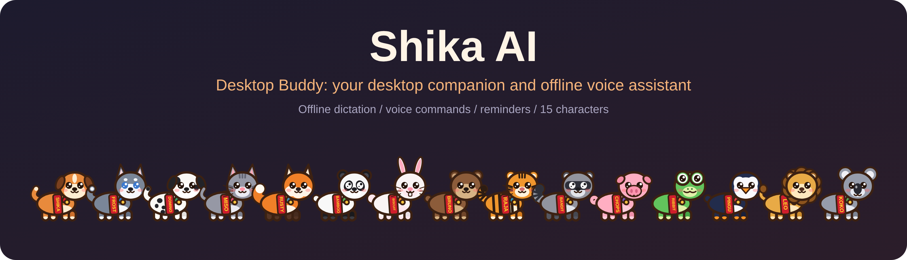
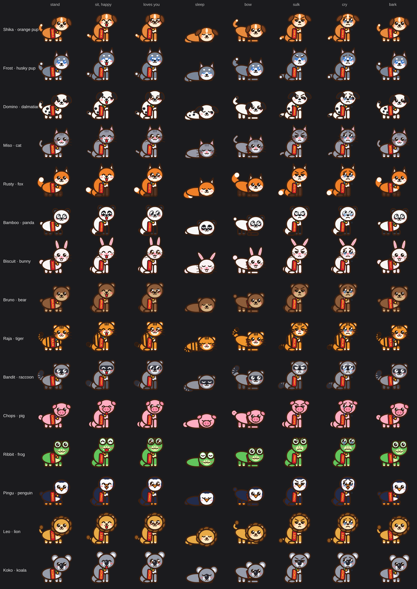

<div align="center">



<br>

**Hold a key, talk, and your words appear in any app. A small pet companion on your desktop does the rest.**

[Landing page](https://iam-knr.github.io/desktop-buddy/) · [Setup guide for Linux, macOS and Windows](https://iam-knr.github.io/desktop-buddy/guide.html)

Offline voice dictation, voice commands, reminders and notes, with a speech model and an optional language model that run on your own computer. The desktop buddy can be renamed and reskinned.

<br>


[Install](#install) · [Shika AI](#shika-ai-and-models) · [What it does](#what-it-does) · [Voice commands](#voice-commands) · [Characters](#the-15-characters) · [Platforms](#platform-support) · [FAQ](#faq)

</div>

---

## What is Shika AI?

Shika AI (also called Desktop Buddy) is an open source **desktop companion and offline voice assistant** written in Python and PyQt6. A small animated pet companion lives on your screen. You hold a key, speak, and let go. Your speech is turned into text on your own machine with [faster-whisper](https://github.com/SYSTRAN/faster-whisper), then typed into whatever app you were using.

No account. No cloud speech service. Your audio never leaves your computer.

It started as a personal tool for dictation and reminders on a Kubuntu desktop. The pup is called Shika by default, and you can rename it. Version 3.18 added 15 characters, per-character names and taskbar awareness. This release adds Mac and Windows support.

## What it does

| Feature | How it works |
|---|---|
| **Push-to-talk dictation** | Hold Right Ctrl, speak, release. The text is typed at your cursor in any app. |
| **Voice commands** | Hold Right Alt (Right Option on a Mac) and say what you want. Open apps, close tabs, lock the screen, change the volume, search the web. |
| **Edit selected text by voice** | Select text anywhere, say "fix grammar" or "make it shorter". A small local model rewrites it in place. Undo with Ctrl+Z. |
| **Reminders and tasks** | "Remind me at 5 to call Rahul." At the time, the pet runs to the middle of the screen and barks. |
| **Notes with history** | Dictations and scratchpad notes are kept as titled entries with version history you can restore. |
| **15 characters, your names** | Three pups and twelve other pet companions. Rename any of them. The name works as a wake word. |
| **Taskbar awareness** | The pet finds your taskbar or Dock and stands on top of it, even if you move it. |
| **Desktop widgets** | Tasks and reminders, sticky notes, a focus timer and a clock. They float on your desktop on Linux, macOS and Windows and remember where you left them. |
| **Name on the belt** | Every character wears a red belt with its name in yellow. Rename it and the belt changes. |
| **Private by default** | Speech recognition runs locally. The AI cleanup step is optional and also local, through [Ollama](https://ollama.com). |

## The 15 characters

<p align="center">
  
</p>

Three pups: **Shika** (orange pup), **Frost** (husky), **Domino** (dalmatian).
Twelve others: **Miso** (cat), **Rusty** (fox), **Bamboo** (panda), **Biscuit** (bunny), **Bruno** (bear), **Raja** (tiger), **Bandit** (raccoon), **Chops** (pig), **Ribbit** (frog), **Pingu** (penguin), **Leo** (lion) and **Koko** (koala).

Each one has eight poses and its own mood. Everything is drawn in code with QPainter, so there are no image files to load and the pet stays sharp at any size.

Switch by voice: "be a panda", "switch to Frost", "call yourself Momo", "surprise me".

## Install

You need Python 3.10 or newer. The first run downloads a speech model of about 500 MB.

**Linux (tested on Kubuntu, KDE Plasma)**

```bash
git clone https://github.com/iam-knr/desktop-buddy.git
cd desktop-buddy
bash install.sh
```

Log out and back in once. This is only needed the first time, so push-to-talk can read your keyboard.

**macOS**

```bash
git clone https://github.com/iam-knr/desktop-buddy.git
cd desktop-buddy
bash install-mac.sh
```

macOS will ask for three permissions: Microphone, Input Monitoring and Accessibility. The installer prints the exact steps.

**Windows 10 and 11**

```powershell
git clone https://github.com/iam-knr/desktop-buddy.git
cd desktop-buddy
.\install-windows.bat
```

Or just double-click `install-windows.bat` after downloading the ZIP.

The installer asks if you want Shika AI, the local language model (about 1 GB). Use `--no-ai` (Mac and Linux) or `-NoAI` (Windows) to skip the question.

## Shika AI and models

Two small models do the work. Both run on your computer.

| Model | Job | Default | Installed |
|---|---|---|---|
| Speech model (faster-whisper) | Turns your voice into text | `small.en`, about 500 MB | Always |
| Language model (Ollama) | Cleans up dictation and edits selected text | `qwen2.5:1.5b`, about 1 GB | The installer asks. Default answer is yes. |

If you skip the language model, Shika still works. It uses quick rule based cleanup. Voice edits such as "make it shorter" need the language model. Skip the question with `--no-ai` (`-NoAI` on Windows) and add the model later with `--with-ollama` (`-WithOllama`).

**Change the language model**

1. Pick a model from the [Ollama library](https://ollama.com/library).
2. Run `ollama pull qwen2.5:3b` (use your model name).
3. Open the installed `shika.py`, find `OLLAMA_MODEL` and put your model name in the quotes.
4. Restart Shika.

| Model | Size | Notes |
|---|---|---|
| `qwen2.5:1.5b` | about 1 GB | Default. Fast on a CPU. |
| `llama3.2:1b` | about 1.3 GB | Small and quick. |
| `qwen2.5:3b` | about 1.9 GB | Better wording. Slower. |
| `llama3.2:3b` | about 2 GB | Another 3B option. |
| `qwen2.5:7b` | about 4.7 GB | Needs 8 GB or more of memory. Slow on a CPU. |

**Change the speech model.** Edit `WHISPER_MODEL`: `base.en` (fastest), `small.en` (default), `medium.en` (more accurate, slower), or a multilingual name such as `small`, `medium` or `large-v3`. For other languages set `WHISPER_LANG = None` to auto detect, or a code like `"hi"`.

**Another computer.** Set `OLLAMA_URL` to a machine on your network that runs Ollama. Only the Ollama API is supported. Hosted chat APIs need code changes.

The installed file is `~/.local/share/shika/shika.py` on Linux, `~/Library/Application Support/ShikaApp/shika.py` on macOS and `%LOCALAPPDATA%\ShikaApp\shika.py` on Windows. The installer overwrites it, so to keep your change make it in `shika/shika.py` in the cloned folder before you install. Full steps are in the [setup guide](https://iam-knr.github.io/desktop-buddy/guide.html#ai-models).

## Voice commands

Hold the command key and say any of these.

```text
open firefox                          remind me at 5 to call Rahul
close tab                             remind me in 20 minutes to drink water
lock screen                           add task upload session recording
volume up / mute                      note GA4 case study idea
search DV360 line item setup          be a panda / switch to Frost
play lofi beats on YouTube            call yourself Momo
what time is it                       fix grammar / make it shorter
```

Closing is careful. "Close YouTube" closes that tab, never the whole browser. "Close Chrome" closes the app, then checks and tells you if it really closed.

## Platform support

| | Linux | macOS | Windows |
|---|:-:|:-:|:-:|
| Pet, dashboard, 15 characters, names | Yes | Yes | Yes |
| Push-to-talk dictation | Yes | Yes | Yes |
| Voice commands | Yes | Yes | Yes |
| Reminders, notes, version history | Yes | Yes | Yes |
| Taskbar or Dock awareness | Yes (reads Plasma panels) | Yes (via Qt) | Yes (via Qt) |
| Desktop widgets (tasks, notes, focus, clock) | Yes, plus native KDE Plasma widgets | Yes | Yes |
| Lowers other audio while you talk | Yes | Yes | No |
| System notifications | Yes | Yes | The pet's bubble is used |

**Be aware:** Linux is the main platform and has the full test suite. The macOS and Windows backends were written later and tested with simulated keyboard, microphone and window layers, not on real machines yet. They should work, but treat them as early. If something breaks, please [open an issue](../../issues) with your `error.log` and OS version. Details are in [docs/platforms.txt](docs/platforms.txt).

## How it works

```text
 hold key ──> microphone ──> faster-whisper (local) ──> text
                                                         │
                     ┌───────────────────────────────────┤
                     v                                   v
              typed at your cursor              command parser ──> open app, remind,
              (or the scratchpad)                                   switch character, ...
                                                         │
                                          optional: Ollama rewrites selected text
```

One file, `shika/shika.py`, holds the whole app. Platform code sits behind `IS_LINUX`, `IS_MAC` and `IS_WIN` flags. On Linux it uses evdev and uinput for keys. On Mac and Windows it uses pynput and sounddevice.

## Configuration

Settings are at the top of `shika/shika.py`. The common ones:

| Setting | Default | Meaning |
|---|---|---|
| `WHISPER_MODEL` | `small.en` | Speech model. `base.en` is faster, `small.en` hears accents better. |
| `WHISPER_LANG` | `en` | Set to `None` with a multilingual model to auto-detect. |
| `OLLAMA_MODEL` | `qwen2.5:1.5b` | Model for voice text editing. |
| `DICTATE_KEY`, `COMMAND_KEY` | Right Ctrl, Right Alt | The two hold-to-talk keys. |

## Uninstall

```bash
bash uninstall.sh          # Linux
bash uninstall-mac.sh      # macOS
.\uninstall-windows.bat    # Windows
```

Your notes and settings are kept unless you add `--purge-data` (or `-PurgeData` on Windows) and type DELETE to confirm.

## Tests

```bash
bash tests/run.sh
```

This runs the real app code without a display, using a stand-in for Qt. It covers closing apps, text editing, dictation, parsers, key handling, taps, characters, and the Mac and Windows backends. To draw every character without Qt installed: `python3 tests/preview_chars.py out.svg`.

## FAQ

**Is my voice sent anywhere?**
No. Speech recognition runs on your machine. The only downloads are the model files on first run.

**Does it work offline?**
Yes, after the first model download.

**Can I use other languages?**
The default model is English only. Switch `WHISPER_MODEL` to a multilingual one and set `WHISPER_LANG = None` to try others. This is not well tested.

**Can I add my own character?**
Yes. Characters are plain data entries in the `CHARACTERS` list in `shika/shika.py`. Copy one and change the colors, ears, tail and face.

**Why Python and not Electron?**
It starts fast, uses little memory and keeps all the voice code in one language.

**Does it need a GPU?**
No. It runs on CPU. There is an optional experimental script for Intel graphics in `tools/ollama-gpu.sh`.

## More docs

- [Landing page](https://iam-knr.github.io/desktop-buddy/) and [setup guide](https://iam-knr.github.io/desktop-buddy/guide.html)
- [Widgets, shortcuts, tuning and data files](docs/desktop-widgets-and-usage.md)
- [Platform notes and restart commands](docs/platforms.txt)

## Contributing

Bug reports with `error.log` attached are the most useful thing right now, especially from real Mac and Windows machines. Pull requests are welcome.

## Related searches

shika ai, desktop buddy, desktop companion, voice assistant for Linux, offline dictation, speech to text, push to talk, faster-whisper app, whisper desktop app, local AI assistant, PyQt6 desktop app, KDE Plasma, Ollama voice, cross-platform voice typing, reminder app with voice.

## License

MIT. See [LICENSE](LICENSE).

Built by [Kailas Nath R (KNR)](https://github.com/iam-knr).
